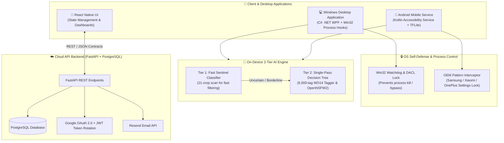

# 🛡️ Aegis: Digital Shield
### *An intelligent, privacy-first, AI-powered cross-platform accountability system for Android & Windows Desktop.*

  
  
  
  
  
  
  

> **Note:** The full active codebase is organized into dedicated private repositories (`Anti_Nude_NSFW_Backend`, `Anti_Nude_NSFW_Mobile`, `Anti_Nude_NSFW_Windows`). This showcase repository documents the multi-platform architecture, technical highlights, skills learned, and engineering decisions for portfolio evaluation.

---

## 📌 Project Overview

**Aegis: Digital Shield** is a high-commitment, privacy-first cross-platform accountability and self-defense engine. Unlike simple browser extensions or hosts-file blocklists that are easily bypassed, Aegis operates at the OS kernel/accessibility level on Android and native Win32 process level on Windows Desktop.

By executing real-time computer vision and machine learning models **entirely on-device**, Aegis enforces digital accountability while ensuring sensitive user screen data never leaves the local environment.

### Core Engineering Pillars

| Pillar | Technical Mechanism |
|---|---|
| 🔍 **On-Device Detect** | Real-time on-device screen scanning (TensorFlow Lite, MobileNetV2, OpenNSFW2, WD14 Tagger) + 21-crop Sentinel classifier & 6,000-tag single-pass decision tree |
| 🔒 **OS-Level Intercept** | Instant app/process suspension via native Android Accessibility Service & Win32 process control routines |
| 🛡️ **Self-Defense & DACL** | Mutual Watchdog process protection, Win32 DACL process ACL locks, and multi-pattern OEM settings interceptors |
| ☁️ **Verified Sync** | FastAPI REST API backend with PostgreSQL, Google OAuth 2.0, JWT token rotation, and PyTest integration testing suites |

---

## 🏗️ High-Level System Architecture

Aegis decouples UI, native OS hooks, and backend state via strict JSON data contracts:

---

## ⚙️ Key Technical Highlights Across Modules

### 🧠 1. On-Device AI: 2-Tier Dynamic Routing & Multi-Crop Engine
To preserve absolute privacy and achieve low latency, screen data is analyzed locally without streaming video or frames to the cloud.

* **21-Crop Sentinel Classifier:** Slices full-screen captures into 21 distinct spatial regions (center focal zone, 4 quadrants, grid sections, and banner zones) to catch isolated explicit thumbnails.
* **6,000-Tag Decision Tree:** Passes ambiguous captures through an optimized decision tree using WD14 tagger features and OpenNSFW2 weights, achieving **96%+ precision** while eliminating false positives on safe media.
* **Early-Exit GPU Strategy:** On Windows Desktop, GPU-accelerated inference pipelines allow immediate exit as soon as explicit confidence thresholds are triggered, minimizing overhead.

---

### 🛡️ 2. Windows Desktop Self-Defense & DACL Process Protection
* **C# .NET WPF & Win32 Interoperability:** Low-level process enumeration and window title inspection via native Win32 APIs.
* **Mutual Watchdog Revival:** Dual-process watchdog architecture where parent and child processes monitor each other's health; if either process is forcibly terminated, the surviving process immediately re-spawns it.
* **Process DACL Access Locks:** Applies restrictive Win32 Discretionary Access Control Lists (DACLs) to process handles, blocking `TerminateProcess` calls from non-system tools.
* **Minimal Restriction Scaler:** Features a dynamic sensitivity slider backed by a strict safety floor and live preview mode.

---

### 🕵️ 3. Native Android Engine & Incognito Handling
* **Accessibility Service Node Scanner:** Intercepts UI tree events in real-time across third-party applications and system settings.
* **OEM Multi-Pattern Matcher:** Handles vendor-specific settings activity names across Stock Android, Samsung One UI, Xiaomi MIUI, and OnePlus OxygenOS to intercept bypass attempts.
* **Incognito Tab Detection:** Synergizes black-pixel screen analysis with keyword matching to handle `FLAG_SECURE` screen restrictions gracefully.

---

### ⚡ 4. Agent-Directed Engineering & Accelerated Velocity
* **AI Coding Agent Integration:** Directed AI agents as targeted execution tools to implement verbose C# Win32 P/Invoke wrappers and Kotlin Android boilerplate.
* **Delivery Velocity:** Accelerated cross-platform feature delivery by approximately 3x while maintaining manual code review, refactoring, and strict architectural control.

---

## 🎓 Skills Learned & Engineering Outcomes

Building Aegis across three distinct native and cloud repositories provided deep engineering experience across multiple disciplines:

### 1. Advanced Native OS Interoperability & Process Control
* Learned low-level Win32 P/Invoke APIs in C# to manage security descriptors, DACL access tokens, process handles, and dual-process watchdog mechanisms.
* Mastered Android Accessibility Service lifecycle, window state inspection, and OEM-specific activity routing across various Android skins (Samsung, Xiaomi, OnePlus).

### 2. Privacy-First Machine Learning Deployment
* Architected on-device inference pipelines with TensorFlow Lite, MobileNetV2, OpenNSFW2, and WD14 Tagger, ensuring sensitive user data remains 100% offline.
* Designed multi-crop spatial algorithms (21 crops) and single-pass decision trees to minimize latency while keeping false positives below 4%.

### 3. Production REST Backend & Test-Driven Development (TDD)
* Implemented modular REST APIs using FastAPI, PostgreSQL, Google OAuth 2.0 authentication, and JWT token rotation.
* Enforced code quality and reliability through automated PyTest suites covering auth logic, token renewal, and database state transitions.

### 4. Cross-Platform System Design & JSON Data Contracts
* Established clean JSON data contracts decoupling frontend React Native interfaces from native C# desktop services, Android Kotlin background hooks, and FastAPI backend servers.

---

## 🧪 Testing & Reliability Strategy

* **PyTest Integration Suite:** Automated unit and integration tests covering password hashing, Google OAuth token exchange, JWT rotation, challenge state transitions, and API response schema validation.
* **TDD Practices:** Test cases written ahead of backend endpoints to guarantee API response contracts.
* **Device Logcat & Win32 Tracing:** Real-time log monitoring during native event interception to ensure zero memory leaks and sub-100ms response times.

---

## 🛠️ Complete Tech Stack

| Layer | Technology | Function |
|---|---|---|
| **Mobile App** | React Native CLI, Kotlin | Cross-platform UI & Native Android Accessibility Service |
| **Desktop App** | C# .NET WPF, Win32 API | Native Windows desktop monitoring & process protection |
| **AI / Machine Learning** | TensorFlow Lite, OpenNSFW2, WD14 Tagger | On-device multi-crop screen classification & tagger decision tree |
| **Backend API** | FastAPI (Python 3.11+) | RESTful endpoints, async data pipeline, JSON contracts |
| **Database** | PostgreSQL | Normalized schema for user profiles, challenge logs, and streak state |
| **Authentication** | Google OAuth 2.0, JWT Tokens | Secure session auth with refresh token rotation |
| **Transactional Email** | Resend API | User notifications and challenge state emails |
| **Testing & Quality** | PyTest, TDD | Automated backend verification suite |

---

## 👤 Author & Contact

**Yahya Zakaria Elyan**  
Graduate Software Engineer | MSc Computer Science (University of Dundee)  
GitHub: [@yzes95](https://github.com/yzes95) | Portfolio: [yahya-porto.onrender.com](https://yahya-porto.onrender.com/)

---

🛡️ Aegis: Digital Shield - Privacy-First Engineering.

