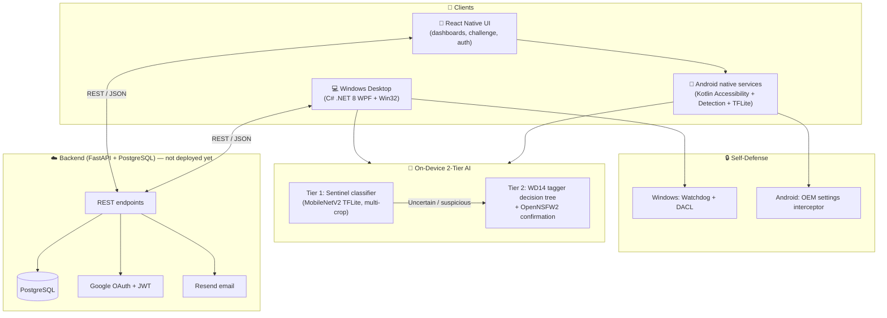

# 🛡️ Aegis: Digital Shield → رفيقي (Rafiqi)
### *A privacy-first, on-device-AI accountability companion for people who want to break porn and compulsive-content habits. Android & Windows.*

  
  
  
  
  
  
  
  

> **Note:** The full codebase lives in three private repositories (`Anti_Nude_NSFW_Backend`, `Anti_Nude_NSFW_Mobile`, `Anti_Nude_NSFW_Windows`). This public showcase documents the architecture, what is built, what is not, and the plan. It is kept in sync with those repos (last verified October 2026).

---

## 📌 Project Status (honest summary)

**Pre-release prototype. Not published on any app store, with no public users yet.**

| Component | Repo | Status |
|---|---|---|
| **Android app** (React Native UI + Kotlin Accessibility/Detection services + TFLite) | `Anti_Nude_NSFW_Mobile` | ✅ Phases 1–2 done, Phase 3 self-defense (settings interceptor, device admin) implemented. Needs real-world testing and Play-policy review. |
| **Windows app** (C# WPF client + Python AI microservice + Watchdog) | `Anti_Nude_NSFW_Windows` | ✅ Tier 1 & Tier 2 detection, shield history, auth, sensitivity slider, mutual watchdog + DACL protection. 🚧 3-strike warning and pop-up-ad protection are not built. |
| **Backend** (FastAPI + PostgreSQL) | `Anti_Nude_NSFW_Backend` | ✅ Auth (email + code verification, Google OAuth, JWT refresh) and a Gemini chat proxy. ❌ Not deployed yet, 1 commit, **no automated tests yet**. |
| **iOS** | n/a | ❌ Not started. Apple's APIs allow much less than Android's. |
| **Predictive behaviour AI / CBT companion / sleep module** | n/a | 📝 Research concept (see the PhD proposal), not implemented. |

---

## 🆕 Planned: Rebrand to **رفيقي / Rafiqi** ("my companion")

Aegis is evolving from a "security shield" into a **companion** that supports someone through an urge, before and after a trigger. These are **plans only, with no code changes yet**:

- **Name:** رفيقي (Rafiqi / Rafeeqi) as the brand. Aegis remains the internal codename until the rename is done.
- **Tagline ideas:** *"Your companion for better habits."* / *"A companion for breaking unwanted habits."* The word "addiction" stays out of the brand name, so it feels warm instead of clinical.
- **Mascot:** an **original** friendly, wise, mentor-like baboon/monkey character. It must **not** use or resemble Disney's Rafiki (face, markings, clothing, staff, rendering style), to avoid copyright and trademark problems.
- **Trademark and availability checks (before any filing):** search the UK IPO and other relevant registers for رفيقي / Rafiki / Rafiqi in software and app classes, check app store names, and check domain availability.
- **Technical rename scope (later):** app display name, icons, package IDs (`com.aegisapp`), Windows executables, backend names and email templates.

## 🆕 Planned: Companion warnings for non-subscribers ("Warn mode")

Today, detection leads to a block, an app suspension or a lockdown. The plan adds a gentler mode:

- **Free / non-subscribed users:** when content is detected, **warn instead of block**. A friendly on-screen AI companion appears (inspired by the old desktop assistants such as the animated paperclip, but **an original character**) and says that what you are doing isn't good for you and can lead to worse outcomes. It offers help (breathing, a distraction, an accountability message).
- **Subscribed / committed users:** the existing strict behavior (block, lockdown, challenge period, self-defense) stays.
- **Windows:** a transparent always-on-top overlay window with the mascot and message. This ties into the existing Stage 2 "3-Strike Grace Warning" idea.
- **Android:** an overlay or notification-style warning. The overlay permission, Accessibility API use and Google Play policy must be checked first.
- **Business rationale:** the free tier demonstrates value without hard enforcement, and enforcement and the companion are the reasons to subscribe.

---

## 📌 Project Overview

Aegis (soon رفيقي) is a high-commitment accountability engine. Unlike browser extensions or hosts-file blocklists, it works at the **Android Accessibility Service** level and the **native Win32 process** level on Windows, and it analyzes what is *actually on the screen* with on-device ML. Screenshots are analyzed locally and are not sent to the cloud by design.

### Core Engineering Pillars

| Pillar | Technical Mechanism |
|---|---|
| 🔍 **On-Device Detection** | Screen scanning with TensorFlow Lite (MobileNetV2 Tier 1) plus Tier 2 models: WD14 Tagger (6,000+ tags, anime/drawn content) and OpenNSFW2 (real-life content). **Windows:** 21-crop active-window scan. **Android:** 8-region multi-crop scan. |
| 🔒 **OS-Level Intercept** | Android: Accessibility Service (UI tree scanning, app suspension, back-tap + Home behavior, uninstall/settings interceptor, Device Admin). Windows: process/window control and an overlay lock. |
| 🛡️ **Self-Defense** | Windows: mutual Watchdog revival and process DACL protection. Android: OEM-aware settings interceptor. |
| ☁️ **Backend** | FastAPI + PostgreSQL, email verification (Resend), Google OAuth, JWT access/refresh tokens, Gemini chat proxy. |

---

## 🏗️ High-Level System Architecture

---

## ⚙️ Key Technical Highlights

### 🧠 1. On-Device AI: 2-Tier Routing & Multi-Crop
- **Windows Tier 1 (21 crops):** slices the active window into focal, quadrant, grid and banner regions to catch small explicit thumbnails.
- **Android (8 regions):** full screen, center, top, bottom and 4 quadrants, run every ~10 seconds or immediately on a text trigger.
- **Tier 2 (Windows):** a single-pass 4-case decision tree (`HARDCORE`, `EDGE_CASE`, `WARDROBE`, `META` tags) over WD14 tagger output, plus an OpenNSFW2 multi-crop confirmation for real-life content. The `WARDROBE` set exists specifically to reduce false blocks on swimwear and underwear shopping.
- **Accuracy:** the repos document high precision as a **design target** (up to "99%+" in the Tier 2 notes). **No formal benchmark or evaluation dataset results have been published yet.** Treat any precision number as unverified until a benchmark is run.

### 🛡️ 2. Windows Self-Defense
- C# .NET 8 WPF client with Win32 interop for window/process inspection, plus a Python AI microservice.
- **Mutual Watchdog:** two processes monitor each other and revive each other if one is killed.
- **DACL protection:** restrictive process access rules so non-system tools cannot terminate the Watchdog easily.
- **Sensitivity slider** with a safety floor, locked during an active challenge.
- *Still open:* registry/Task Manager hardening, uninstall prevention during a challenge, 3-strike grace warnings, pop-up-ad protection.

### 🕵️ 3. Native Android Engine
- **Accessibility Service:** scans the UI tree (URLs, text) for high-risk keywords and tracks browser installs.
- **App suspension:** shifted from overlays to blocking the offending app for a penalty period. Browser pages are replaced with `about:blank` and the user is sent Home (incognito and non-browser apps also get rapid back-taps first).
- **Zero-tolerance app lists** for known NSFW apps and games.
- **Settings interceptor** for Accessibility, Device Admin, App Info, Clear Data and Uninstall screens, with OEM-aware handling.
- ⚠️ **Policy risk:** Google Play restricts non-accessibility uses of the Accessibility API. This design may need a different distribution path (direct APK, companion architecture) or a policy review before a Play Store release.

### ⚡ 4. AI-Assisted Development
- AI coding agents were used for boilerplate such as Win32 P/Invoke wrappers and Kotlin scaffolding, with manual review and architecture decisions. Any speed-up figure is a personal estimate, not a measured result.

---

## 🧪 Testing & Reliability: current reality

- **Backend:** designed with pytest/TDD in mind, but **no automated test suite exists in the repo yet**. This is on the roadmap.
- **Mobile:** Jest is configured, with a single smoke test (`App.test.tsx`).
- **Windows:** some ad-hoc Python test scripts (e.g. `test_blocker_service.py`), with no CI test suite.
- **Primary validation so far:** manual device testing using logcat traces and a large set of debugging screenshots covering false positives, missed blocks and incognito edge cases.

## 🗺️ Roadmap
1. **Validation:** waiting-list landing page for رفيقي, check demand by platform (Android / Windows / iPhone), and interview people in recovery communities.
2. **Distribution decision:** Google Play policy review for the Accessibility API; Windows-first or direct-APK fallback.
3. **Brand:** rename to رفيقي/Rafiqi, original mascot, trademark search.
4. **Warn mode** for free users and strict mode for subscribers.
5. **Backend:** deploy, add tests, add rate limiting, privacy policy.
6. **Evaluation:** build a labeled benchmark and publish real precision/recall and false-positive numbers.
7. **Later:** predictive behavior model, companion chat, and sleep/short-form-content modules (research track).

---

## 🛠️ Tech Stack

| Layer | Technology | Function |
|---|---|---|
| **Mobile App** | React Native CLI, Kotlin | UI and native Android Accessibility/Detection services |
| **Desktop App** | C# .NET 8 WPF, Win32 API, Python microservice | Windows monitoring, AI inference and self-defense |
| **AI / ML** | TensorFlow Lite (MobileNetV2), OpenNSFW2, WD14 Tagger | On-device multi-crop screen classification |
| **Backend API** | FastAPI (Python 3.11+) | Auth, user profile, Gemini chat proxy |
| **Database** | PostgreSQL (SQLAlchemy) | Users and verification state |
| **Auth** | Google OAuth 2.0, JWT | Sessions with refresh tokens |
| **Email** | Resend | Verification codes |

---

## 👤 Author & Contact

**Yahya Zakaria Elyan**  
Graduate Software Engineer | MSc Computer Science (University of Dundee)  
GitHub: [@yzes95](https://github.com/yzes95) | Portfolio: [yahya-porto.onrender.com](https://yahya-porto.onrender.com/)

---

🛡️ Aegis → رفيقي: privacy-first engineering for habit recovery.

